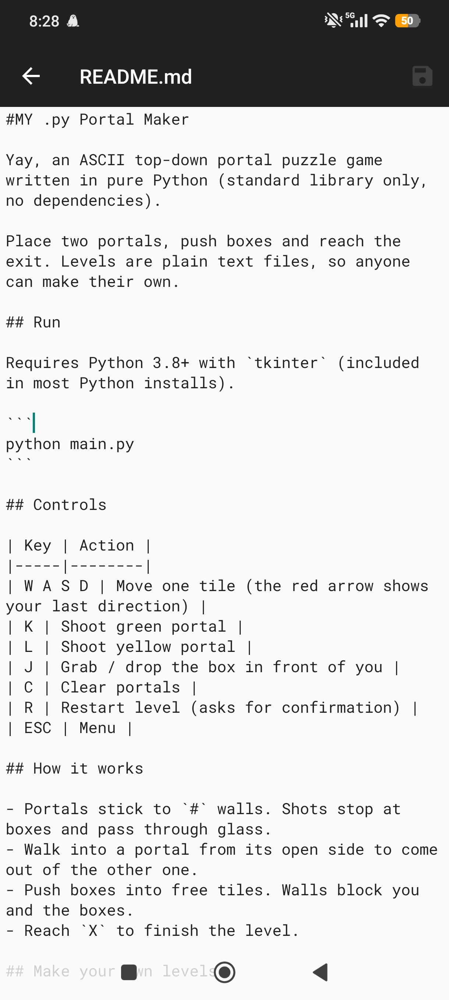
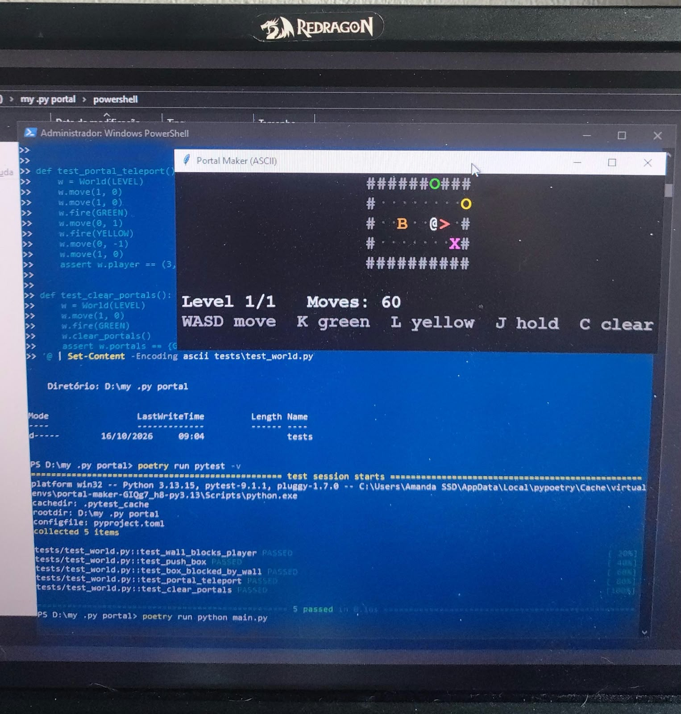

My .py Portal Maker

Yay, an ASCII top-down portal puzzle game written in pure Python (standard library only, no dependencies).

Place two portals, push boxes and reach the exit. Levels are plain text files, so anyone can make their own.

Requires Python 3.8+ with `tkinter` (included in most Python installs).

```
python main.py
```

I actually tested only with poetry run python main.py on Powershell


Controls

| Key | Action |
|-----|--------|
| W A S D | Move one tile (the red arrow shows your last direction) |
| K | Shoot green portal |
| L | Shoot yellow portal |
| J | Grab / drop the box in front of you |
| C | Clear portals |
| R | Restart level (asks for confirmation) |
| ESC | Menu |

### How it works

- Portals stick to `#` walls. Shots stop at boxes and pass through glass.
- Walk into a portal from its open side to come out of the other one.
- Push boxes into free tiles. Walls block you and the boxes.
- Reach `X` to finish the level.

Make your own levels

Every `.txt` file in `maps/` is a level, played in alphabetical order.

| Char | Meaning |
|------|---------|
| `#` | Wall (portals can stick here) |
| `.` | Floor |
| `=` | Glass (blocks walking, portal shots pass) |
| `@` | Player start |
| `B` | Box |
| `X` | Exit |

Project structure

```
main.py     window, input, ASCII drawing, menus
world.py    rules and minimal physics (collision, boxes, portals)
levels.py   loads maps/*.txt
maps/       level files
```

#
#

## License

GPL-3.0-or-later. See [LICENSE](LICENSE).
